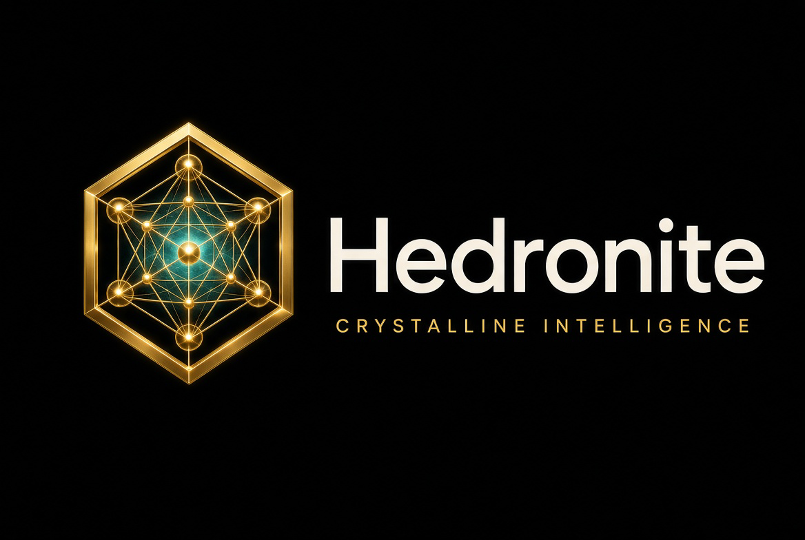

  

<strong>Crystalline Intelligence, Orchestration Refined</strong>

  <a href="https://hedronite.com">hedronite.com</a> ·
  <a href="https://github.com/VirtualMachinist">Systems Architect</a>

---

Hedronite designs and deploys websites, builds software and training resources for DevSecOps engineers, and develops **Hedronaut**: an AI platform of modular applications for AI workflows and agentic software engineering.

Hedronaut is five families of tools. Each family answers one question.

## I. Core

*What runs the platform, and what does an agent carry?*

| Application | Function |
|---|---|
| **[tetra-cli](https://github.com/Hedronite/tetra-cli)** | World command of the platform: one verb over Facet, HedronDB and h3s |
| **[facet](https://github.com/Hedronite/facet)** | API client for humans and agents that keeps every run as queryable history |
| **[hedrondb](https://github.com/Hedronite/hedrondb)** | Local-first intent store: reconciles what should be true with what is |
| **[hedronetes-h3s](https://github.com/Hedronite/hedronetes-h3s)** | Agent-native orchestration node that runs beside K8s / k3s |
| **[lapis-lattice](https://github.com/Hedronite/lapis-lattice)** | Markdown notes vault with search and RAG for agentic workflows |
| **[phantom](https://github.com/Hedronite/phantom)** | Code-graph engine for Rust with a CLI and MCP server |
| **[geode](https://github.com/Hedronite/geode)** | Encrypted file custody for humans and agents (GDE1 vaults) |
| **[bezel](https://github.com/Hedronite/bezel)** | Harness-agnostic overlay: skills, the Jev policy gate, adapters |

## II. Vigil

*Is everything healthy?*

| Tool | Function |
|---|---|
| **[simplex](https://github.com/Hedronite/simplex)** | Read-only mesh probe: host health as JSON and Prometheus metrics |
| **[augur](https://github.com/Hedronite/augur)** | Classifies Alertmanager alerts into GREEN / YELLOW / RED verdicts |
| **[vigil](https://github.com/Hedronite/vigil)** | Combines the verdicts into one summary for people, agents and Facet |
| **[cubit](https://github.com/Hedronite/cubit)** | Exports Cargo disk usage on build hosts as Prometheus metrics |
| **[scry](https://github.com/Hedronite/scry)** | Read-only readiness check for h3s and Kubernetes clusters |

## III. TOPS

*Is the code fit to ship?* Testing and Optimization Protocol Suites, one per language.

| Protocol | Covers |
|---|---|
| **[rust-tops](https://github.com/Hedronite/rust-tops)** | Rust, with `cargo tops` and a laws layer proven in Bend and rechecked in Lean |
| **[go-tops](https://github.com/Hedronite/go-tops)** | Go |
| **[nix-tops](https://github.com/Hedronite/nix-tops)** | Nix flakes, packages and modules |
| **[web-tops](https://github.com/Hedronite/web-tops)** | TypeScript, HTML and CSS: correctness, accessibility and speed |

## IV. Surfaces

*Where do people meet it?*

| Surface | Function |
|---|---|
| **[luminosi-ts](https://github.com/Hedronite/luminosi-ts)** | Modular TypeScript visual library: icons, Three.js primitives, scenes, shaders |
| **[pendant](https://github.com/Hedronite/pendant)** | Mobile thin client for herdr agent sessions, over Tailscale |

## V. Academy

*How is it taught?*

| Resource | Purpose |
|---|---|
| **[hedrondojo](https://github.com/Hedronite/hedrondojo)** | Terminal student lab and DevOps workshop that pulls fullstack-lab for in-app training |
| **[fullstack-lab](https://github.com/Hedronite/fullstack-lab)** | Fullstack practice lab (dev languages + DevSecOps) using published lessons |

---

Install with `brew tap Hedronite/tap` ([homebrew-tap](https://github.com/Hedronite/homebrew-tap)). Reproducible Python environments start from [python-gate](https://github.com/Hedronite/python-gate).
